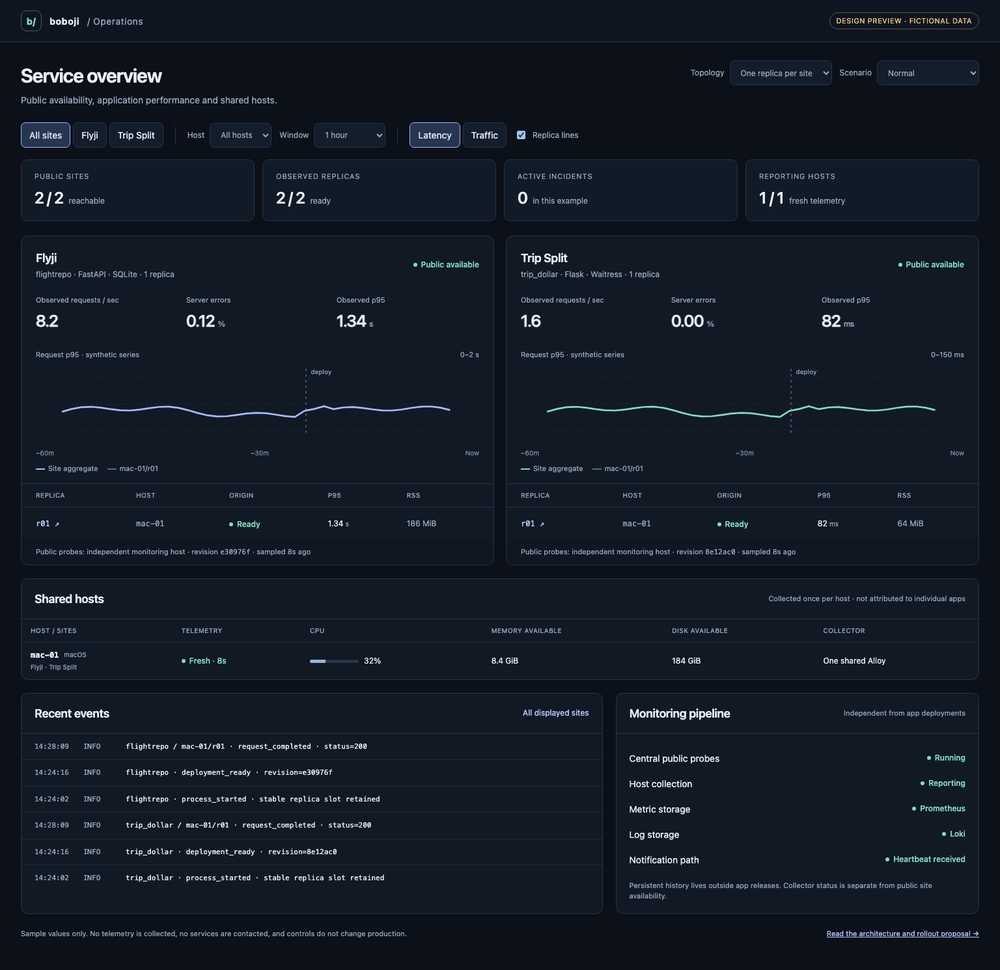
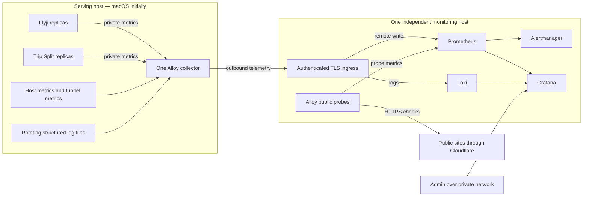

# Shared monitoring for boboji

Status: proposal for review, researched October 17, 2026. Nothing in this proposal installs a monitoring service or changes application instrumentation.

Use one private Grafana workspace backed by one Prometheus, Loki and Alertmanager deployment. Run one Grafana Alloy collector per host, shared by every local app. Maintain the configuration and a small Python instrumentation package in a separate `boboji-observability` repository. Future non-Python services can use the same metric/label protocol with their own small adapter. Each Python app installs the shared package as a pinned dependency; it does not copy dashboards, collectors or deployment scripts.

[Open the interactive layout study](monitoring-preview.html). All values in it are fictional. It demonstrates grouping and drill-down, not a custom dashboard product to build alongside Grafana.



## What the existing installations need

The inspected implementations are:

| Project | Serving stack | Current deployment | Integration point |
| --- | --- | --- | --- |
| `flightrepo` / Flyji | FastAPI, Uvicorn, SQLite | One process at loopback port 8014, separate Cloudflare connector, manually loaded launchd jobs | Installed server assembly in `deployment/serve.py`, application routes in `src/server/api.py` |
| `trip_dollar` / Trip Split | Flask, Waitress, threaded request handling | One process at loopback port 8000, separate Cloudflare connector, manually loaded launchd jobs | `deployment/serve.py` and `src/trip_dollar/server/app.py:create_app` |

Both already have a cheap `/health` endpoint. Flyji's current `/health/ready` counts admitted archive records; its catalog performs broader aggregations. Neither belongs in a frequent availability probe. Trip Split has two calculation slots, but Flyji's proposed interactive-read admission changes are still in PR #22. The monitoring integration must report actual capacity, without introducing that PR's policies.

The current Flyji deployment also retains separately installed ingestion code. Monitoring installation must remain independent of app/ingestion upgrades. Today's rollout exposed two operational signals worth recording: deployment smoke-check failures and the time between requesting launchd shutdown and observing the job fully unloaded.

Source basis: the two repositories' deployment/server implementations, and Flyji main `e30976f`. Initial scope is one replica of each site; ingestion signals are a later explicit integration, not an ingestion rewrite.

## Architecture and ownership



The monitoring host should be a small, always-on Linux machine or VM on a different host from the apps. This separates monitoring availability from Mac sleep, logout and app restarts. It is one logical installation for all sites. Another serving host adds one collector and inventory entries, not another Grafana/Prometheus/Loki stack.

If only the existing Mac is available, a local pilot is possible with persistent storage, but it cannot detect or notify about its own complete host outage. Treat that as a temporary limitation, not as reliable external monitoring. A separate scheduled watchdog must check monitoring's heartbeat from another failure domain before alerting is considered operational.

Use native launchd supervision for the Mac collector, independent of app jobs; use systemd for Linux collectors. A single Compose deployment is the proposed packaging for the **monitoring host**, without changing either serving stack. App deployment never stops, upgrades or deletes the collector or central storage. The apps currently depend on a logged-in, awake Mac; the collector does not change that app-supervision policy. Central probes should report sleep/logout as loss of service. Confirm the monitoring host, private access method and notification destination before installation; no cloud account, paid service or DNS route is created by this design.

| Component | Responsibility | Initial choice |
| --- | --- | --- |
| Grafana OSS | One admin entry point, dashboards, log exploration | Provisioned dashboards with stable UIDs |
| Prometheus | Metrics, recording rules, alert evaluation | Local TSDB; authenticated remote-write ingress from the small host fleet |
| Loki | Searchable application, tunnel and deployment logs | Single binary with persistent TSDB-index/chunk storage |
| Alertmanager | Group, deduplicate and route notifications; silences | One rule/notification path, avoiding duplicate Grafana-managed alerts |
| Alloy | Host metrics, app scrapes, log tailing and probes | One per serving host, one central probe role |
| `boboji-observability` Python package | ASGI/WSGI request metrics, process sampling, JSON logging, operation hooks | Same versioned library in both apps |

Prometheus supports remote-write ingestion at `/api/v1/write`; enable its receiver only behind the authenticated ingestion boundary. This is a small-fleet design. If ingestion or retention outgrows one server, change the metrics backend while retaining the collection contract. [Prometheus storage interfaces](https://prometheus.io/docs/prometheus/latest/storage/).

## Why these choices

Alloy combines host export, scraping, file logs and blackbox probes, so local apps do not need a separate collector stack. Its Unix exporter supports Darwin, including CPU, memory, filesystem, disk and network collectors, although platform coverage differs. Its embedded blackbox exporter avoids another standalone probe process. [Unix exporter support](https://grafana.com/docs/alloy/latest/reference/components/prometheus/prometheus.exporter.unix/), [blackbox component](https://grafana.com/docs/alloy/latest/reference/components/prometheus/prometheus.exporter.blackbox/).

| Alternative | Assessment |
| --- | --- |
| Grafana Cloud | Useful managed alternative if operating the central host is undesirable; account, data residency and budget need approval. Same agent/label contract can be retained. |
| OpenTelemetry Collector with OTLP metrics | Good future path for a mixed-language fleet and traces. Native OTLP ingestion exists in Prometheus. Initial Python apps need simple pull metrics and host/log collection; using two metric export paths would add duplication. |
| Full LGTM stack including Tempo from day one | Add tracing when request spans answer an actual unresolved question. Keep metrics and logs first; no trace backend in the initial installation. |
| One stack per app | Multiplies upgrades, state and dashboards; prevents the shared overview the user requested. |
| Bespoke monitoring UI | Maintain the layout in Grafana; the HTML study is a review aid, not a second frontend to maintain. |
| Kubernetes, Kafka or an HA metrics cluster | Not required for two small services. Revisit based on measured scale or stricter durability/availability requirements. |

OpenTelemetry remains the proposed tracing interface. A later tracing extra can use the same app adapter, exporting asynchronously to the host collector. Use a unique process incarnation for `service.instance.id`, with the stable logical replica ID as a separate attribute. Prometheus's OTLP mapping otherwise derives `instance` from the process identity, so adopting it later needs an explicit mapping rather than silently changing dashboard identity. [Prometheus OTLP guide](https://prometheus.io/docs/guides/opentelemetry/).

## Identity, discovery and redeployments

Use one inventory as the source for collectors, probes, dashboards, expected-target recording rules and deployment metadata. Proposed schema, not a runnable configuration:

```yaml
sites:
  flightrepo:
    title: Flyji
    public_url: https://fly.boboji.fyi
    adapter: asgi
    replicas:
      - id: r01
        host: mac-01
        environment: production
        app_url: http://127.0.0.1:8014
        metrics_url: http://127.0.0.1:8714/metrics
        connector: flyji-mac-01
        log_profile: flyji
  trip_dollar:
    title: Trip Split
    adapter: wsgi
    # Public hostname comes from this app's installed settings.
    replicas:
      - id: r01
        host: mac-01
        environment: production
        app_url: http://127.0.0.1:8000
        metrics_url: http://127.0.0.1:8700/metrics
        connector: trip-split-mac-01
        log_profile: trip-split
connectors:
  flyji-mac-01:
    site: flightrepo
    host: mac-01
    metrics_url: http://127.0.0.1:19314/metrics
  trip-split-mac-01:
    site: trip_dollar
    host: mac-01
    metrics_url: http://127.0.0.1:19300/metrics
```

Ports are proposed reservations, subject to a collision check. They are not selected at random on restart. Resolve loopback targets on the owning host, never on the central server. Scrape each connector once, even if it fronts several replicas; replicas reference its ID rather than duplicating its metrics. Connector labels identify site/host/connector, without inventing per-replica tunnel measurements. Normalize log paths under each private runtime; do not put usernames, full paths or credentials into labels. Validate duplicate IDs, duplicate ports, unknown hosts and missing required fields before generating configuration.

| Identity | Meaning | Where it appears |
| --- | --- | --- |
| `site` | Immutable project slug, e.g. `flightrepo` | All app metrics/log streams, probes and alerts |
| `env` | `production` initially | All telemetry |
| `host` | Persisted inventory ID, e.g. `mac-01` | All telemetry; host metrics collected once |
| `replica` | Stable slot within a site's host, e.g. `r01` | App metrics, local probes and logs |
| `instance` | Relabel to `host/site/replica` for app scrapes | Stable Prometheus target identity |
| revision, PID, boot UUID | Build/process incarnation details | Build-info series, deployment events and log fields; not every series label |

The collector adds trusted target labels; request headers cannot choose them. A new replica has a new ID, metrics port and app port. A replacement of a slot reuses its ID only after the prior process stops. During overlap, a canary/rolling replacement needs a distinct replica ID until the old target is removed.

App counters reset after restart; queries use `rate`/`increase`, never assume a persisted application counter. `process_start_time_seconds` identifies a restart without using the PID as a series dimension. Grafana queries group by stable site/host/replica labels, so history stays on the same view. Deployment events carry both the server revision and adapter version. Host-level views show a host once, even if it serves several sites.

Expected targets are generated into Prometheus rules centrally, independent of the host collector. A missing collector or a vanished inventory target must show **missing telemetry**, not disappear as if healthy. A future decommission removes the inventory entry through review; historical data remains until retention expires.

## Small, explicit application integration

Publish one Python package with `asgi` and `wsgi` extras, a narrow configuration object, a dedicated metric registry and a shared logging formatter. No import-time startup, global Flask/FastAPI monkeypatching, database migration, provider integration or application-owned telemetry database. An example interface for review:

```python
# Proposed API; this package is not implemented yet.
telemetry = Observability.from_runtime(settings, service="flightrepo", replica="r01")
app = telemetry.wrap_asgi(app)         # or wrap_wsgi(app) for Trip Split
telemetry.start()                     # after fork, at serving-process startup
# On graceful server shutdown: telemetry.close()

with telemetry.operation("route_search"):
    result = search(request)
telemetry.result("route_search", outcome="empty")
```

The implementation should:

- Wrap the final serving application so rejects and errors are observed too; obtain a bounded route template from the framework, with `unmatched` as the fallback.
- Keep one dedicated metrics listener bound to `127.0.0.1`, outside the public app router. Bind failure must leave the app serving, emit one actionable diagnostic and make the independent metrics target fail. Do not expose metrics through the Cloudflare app hostname.
- Record request counters, latency and in-flight work in memory. The normal request path does no collector network I/O and no disk/SQLite writes for monitoring. A rotating log handler uses a bounded queue with explicit drop counters; monitoring failures must not make requests fail.
- Finalize metrics once for success, exception, client disconnect and streaming response completion; decrement in-flight gauges in `finally`. WSGI iterable close and ASGI lifespan need explicit handling.
- Sample process CPU/RSS, threads and start time every 15 seconds using a portable collector. Verify Darwin measurements; the Python client's default process collector is not a substitute for this on every OS.
- Exclude assets and probes from user-request SLI counters; record probes separately. Register known result values at zero so no-error traffic is not confused with absent data.
- Leave custom domain metrics opt-in through small operation/result hooks; app code does not import Grafana, Alloy or Loki APIs.

The Python client provides a separate HTTP server and explicit shutdown handles. Each current app is one serving process; Waitress threads can share its registry. [Python metrics HTTP exporter](https://prometheus.github.io/client_python/exporting/http/).

Multiple replicas on one host work by giving each process its own port/registry. Multiple worker processes behind a *single* replica endpoint are a separate integration: initialize after fork and either expose each worker as a monitored instance or implement/test the client's multiprocess mode. Do not turn on `PROMETHEUS_MULTIPROC_DIR` casually: cleanup and collector limitations affect correctness. [Python multiprocess requirements](https://prometheus.github.io/client_python/multiprocess/).

## Signals to collect

Use rates, errors and duration for user-facing work, and resource use/saturation for hosts. Histograms aggregate across replicas; precomputed per-process percentiles do not. Count all requests regardless of log sampling. [Prometheus instrumentation guidance](https://prometheus.io/docs/practices/instrumentation/).

| Layer | Initial signals | How an admin uses them |
| --- | --- | --- |
| Public access | HTTPS success, expected page/health body, TLS expiry, DNS/TLS/connect/response timing | Detect failures outside an otherwise healthy origin |
| Replica | Origin health, metrics scrape success/freshness, process age, restart events, release revision | Separate app failure, telemetry failure and planned rollout |
| Requests | RPS, status class, 5xx/503, cancellations, in-flight count, duration histogram by route template | Compare latency/error changes and identify overloaded routes |
| Process | CPU seconds, RSS, thread/FD counts where supported, configured/occupied application slots where they actually exist | Distinguish resource pressure from downstream/SQL waits |
| Host | CPU busy, load/core, available memory, swap activity, disk free bytes/ratio, disk I/O, network errors/throughput, uptime | Find a shared host bottleneck affecting several sites |
| Flyji serving | Search duration/outcome, empty result vs incomplete result, SQL timing/error class, busy/locked errors, DB/WAL sizes, last successful publication | Distinguish valid no-route results from incomplete work and storage failures |
| Flyji ingestion, later | Last successful job/publication, heartbeat/progress, admitted/rejected records, failures, disk/RAM-workspace use | Detect a stopped pipeline even after its process exits |
| Trip Split | Calculation duration/outcome, occupied calculation slots, 503 count, FX cache hits/misses and upstream timeout/error class | Separate invalid input, overload and dependency trouble |
| Cloudflare connector | Active HA connections, origin proxy errors, request counts, connector restarts | Explain healthy local app with broken public access |
| Monitoring itself | Collector freshness, scrape errors/duration, remote-write lag/failures, queue/WAL pressure, log drops, TSDB/Loki disk, rule errors, notification delivery | Detect a broken monitoring path before trusting a green tile |

Metric names proposed for the common package: `boboji_http_requests_total`, `boboji_http_request_duration_seconds`, `boboji_http_in_flight`, `boboji_operation_duration_seconds`, `boboji_operation_results_total`, and `boboji_build_info`. Add only bounded operation/outcome names; normalize request methods to known methods plus `OTHER`, and status to a fixed class/outcome set. Path parameters and user-supplied labels never become metric dimensions. A result marked `empty` is not an HTTP error. A result marked `incomplete` is visible even when its HTTP status is 200. Search correctness is not proven by monitoring.

Choose classic request histogram buckets covering 5 ms through 120 s, including meaningful service thresholds (e.g. 0.25, 1, 5, 10, 30 s); tune after baselining and keep bucket boundaries consistent across replicas. Health probes have their own latency series, so slow search tails do not distort liveness.

For Darwin, verify CPU/memory/filesystem/disk/network metrics on the actual Mac. Show unavailable Linux-only PSI, cgroup throttling and inode-specific signals as **unsupported**, never zero. Inspect Apple Silicon thermal collection before enabling it; Grafana documents a possible thermal collector failure. [macOS integration caveats](https://grafana.com/docs/grafana-cloud/observe-and-act/monitor-infrastructure/integrations/integration-reference/integration-macos-node/).

Host filesystem capacity uses the durable app/monitoring volume once; avoid summing duplicate APFS mount views or treating a removable/RAM ingestion mount as durable free space. Host-process collectors never export command lines, environment variables or other apps' files.

Cloudflared currently uses a random metrics port in the Flyji launch definition. Change it to the inventory's fixed loopback port only during an approved integration rollout. Scrape connector health separately from app health. [Cloudflare metrics and fixed binding](https://developers.cloudflare.com/cloudflare-one/networks/connectors/cloudflare-tunnel/monitor-tunnels/metrics/).

## Probes that do not overload the sites

- Every 30 seconds, central Alloy checks public `/health`; every minute it checks the root page plus one static asset. Check status and a small expected body, not just a TCP connection. Keep certificate verification enabled.
- Every 15 seconds, host Alloy checks cheap origin health and scrapes metrics. App metrics expose cached/in-memory state only.
- Until Flyji has a cheap schema/connection readiness check, use `/health` for frequent probes. Its current counted readiness and full deployment check remain manual/low frequency; never schedule full archive counts or a broad route search every few seconds.
- Add a deterministic functional synthetic per site on a slower schedule after defining expected results, cost and an overlap lock. Trip Split uses manual rates and fixed example input. Flyji needs a stable, admitted known journey whose facts are intentionally maintained; arbitrary historical URLs can legitimately stop matching. A dataset change must show a fixture issue separately from app outage. Do not start with a paid upstream call or an archive-wide search.
- Keep a post-deployment browser smoke check for the calendar/search controls and calculator workflow; successful HTML/health probes alone cannot detect broken interactions. Reuse each app’s existing browser QA against a reviewed fixture rather than adding a continuous browser fleet.
- Keep origin health, public availability and metrics freshness as distinct signals. With multiple replicas, public success does not establish that every replica is healthy.

The embedded blackbox component caps its probe timeout at 10 seconds. Use a five-second budget for the cheap checks; slow functional jobs need a separate runner and duration signal. [Blackbox timeout behavior](https://grafana.com/docs/alloy/latest/reference/components/prometheus/prometheus.exporter.blackbox/).

## Logs, persistence and honest continuity guarantees

Use one JSON schema: timestamp, severity, site/host/replica metadata, bounded event/operation, route template, status, duration and optional request/trace ID. Application/operation errors and deployment events are retained; successful access logs may be sampled. Redact at source and again in the collector. Do not collect request/response bodies, query strings, expense notes, participant names, IP addresses, cookies, authorization headers, tunnel tokens, raw SQL or ingestion credentials. Loki indexes site/env/host/replica and a small stream kind; request IDs, PIDs and revisions are structured fields, not stream labels. [Label cardinality guidance](https://prometheus.io/docs/practices/naming/).

| State | Owner and location | Redeployment behavior |
| --- | --- | --- |
| Metrics TSDB, rule state/WAL | Persistent monitoring-host volume | Recreating app processes does not affect history |
| Loki index/chunks/compactor state | Persistent monitoring-host volume | Time retention applies; app deployments do not remove logs |
| Grafana database/provisioning, Alertmanager state | Separate persistent volumes | Dashboard UIDs, users, silences and notification dedup state survive restarts |
| Alloy remote-write WAL and file positions | Private host runtime outside app release directories | Collector restart uses the same storage path and stable component IDs |
| Source application logs | Stable per-site/replica log directory with rotation | Preserve across app reinstall; bounded disk allocation |
| Batch-job progress, later | Atomic small status/textfile record outside the running job | Last-success timestamp remains observable when the job has exited |

Alloy's metrics remote-write path uses a WAL, but its retention is finite. Start with an eight-hour replay window and reserve measured disk headroom; an outage longer than the window can lose old samples. File-log positions let tailing resume after restart, but they do **not** prove all previously read batches reached Loki. Its `loki.write` WAL is currently experimental, so do not quietly enable it in the baseline. In-flight logs may be lost or replayed. Keep rotated source logs for recovery and show pipeline loss/freshness. [Metric WAL behavior](https://grafana.com/docs/alloy/latest/reference/components/prometheus/prometheus.remote_write/), [log positions](https://grafana.com/docs/alloy/latest/reference/components/loki/loki.source.file/), [experimental log WAL](https://grafana.com/docs/alloy/latest/reference/components/loki/loki.write/).

If durable log delivery through collector failure is required, evaluate the OpenTelemetry file-backed sending queue in a separate spike, including receiver checkpoints and failure recovery; do not claim exactly-once delivery. An app killed between scrapes can also lose its final counter increments. These are monitoring data limits, not flight-search limits. [Collector resiliency](https://opentelemetry.io/docs/collector/resiliency/).

For job freshness, publish a timestamp of last success rather than a continuously updated "age". A host textfile collector can expose an atomically replaced status file; remove obsolete jobs through inventory review. Avoid a generic Pushgateway for long-lived replicas because target lifecycle/stale-series cleanup would become another responsibility. [Pushgateway lifecycle tradeoffs](https://prometheus.io/docs/practices/pushing/).

## Dashboard and admin workflow

Use one Grafana folder, **boboji Operations**, with three stable dashboards: Overview, Site, and Host. Keep all site definitions in the inventory; adding a site requires no cloned dashboard.

**Overview:** first show public status and data freshness, then one row/card per site with availability, traffic, errors and latency. Each site owns a compact replica table and one shared chart: a strong aggregate line plus subtly different replica lines. Selecting a site filters the same page; selecting a replica highlights it and scopes the adjacent logs. Avoid one large disconnected dashboard per replica. Host capacity appears once in a shared host strip.

**Site:** request rate, availability, route-specific latency, errors/rejections, in-flight work, replica health/processes, operation outcomes and recent deployment annotations. Use fixed colors and line dashes plus labels, so identity does not depend only on color. Default to all replicas. One click opens logs with site/host/replica and the same time range already selected.

**Host:** CPU, memory/swap, disk capacity/I/O, network, collector and connector health, and a table of resident replicas. Clicking a site returns to its site view. Never divide host resource usage across apps as if it were measured per-process usage.

Display zero traffic as **No requests**, an unsupported metric as **Unsupported**, and expired telemetry as **No recent data**. Do not fill missing samples with zero or carry a green status indefinitely. Show a last-observed time, a visible data-gap band, units, a time-range selector, and a deploy marker on graphs. On small screens, site cards stack; replica details remain an expandable table rather than a row of tiny charts.

Provision dashboard/data-source UIDs from Git. Operator edits are experiments until exported/reviewed; production provisioning is the source of truth and can overwrite UI edits. [Grafana provisioning](https://grafana.com/docs/grafana/latest/administration/provisioning/).

Example aggregate query, using the shared labels and per-service routes:

```promql
histogram_quantile(0.95,
  sum by (le, site) (
    rate(boboji_http_request_duration_seconds_bucket{env="production"}[5m])
  )
)
```

Do not average per-replica p95s. Use per-route panels to avoid blending flight routing with static files or Trip Split calculations. At low traffic show request counts/sample size beside percentiles.

## Alerts with a clear action

Prometheus evaluates rules; Alertmanager groups by site/env/alert, lists affected replicas and links to a runbook/dashboard. Host-down alerts inhibit dependent replica/collector noise. A metrics-target failure while public and origin probes succeed is a monitoring warning, not a site outage. Planned deploy silences have an expiry and never hide an extended public outage. [Alertmanager grouping and inhibition](https://prometheus.io/docs/alerting/latest/alertmanager/).

These are proposed starting thresholds, not measured SLO promises:

| Condition | Initial rule/urgency | First action |
| --- | --- | --- |
| Public availability fails | Three failed 30-second probes, critical | Compare origin, tunnel and host status; inspect the deployment timeline |
| Expected replica has no healthy metrics sample | Two minutes, warning; escalate if origin also fails | Check supervisor and metric listener, then collector freshness |
| All replicas of a site unhealthy | One minute, critical | Check shared host/storage, then restore a known release |
| 5xx/503 share >5% | Five minutes and at least 20 requests, warning | Inspect route/operation and capacity; do not mask rejection as success |
| Slow operation | Establish baseline first; separate search/calculation thresholds | Correlate SQL/upstream duration, concurrency and host I/O |
| Storage pressure | <15% available or <10 GiB, warning; <5% or <2 GiB, critical | Identify growth, verify retention, free safe disposable data |
| CPU/memory pressure | Sustained CPU >90% with load, or <10% available memory with swapping, warning | Compare active work across both sites; verify OS-specific semantics |
| Restart loop | Three unplanned start-time changes in 15 minutes, warning | Check private crash logs and deployment state |
| Publication/job stale | Based on the configured expected cadence plus grace; not latest flight date | Inspect last successful publication and job heartbeat |
| Collector/central data gap | No recent host samples for two minutes; queue/write drops visible | Fix telemetry before trusting healthy charts |
| Certificate expiry | <14 days warning, <7 days critical | Verify automated renewal and the serving certificate |

Generate an expected-replica series from central inventory even when the host disappears. A missing-target rule can use `expected unless on(site,env,host,replica) (max_over_time(up{job="app-metrics"}[2m]) == 1)`, with the full expected label set in the generated rule. Distinguish planned decommission from accidental loss.

After a baseline period, propose separate 30-day availability and latency SLOs, then use multi-window error-budget burn alerts. Low traffic requires synthetic checks and absolute counts; one failed request should not produce a misleading percentage incident. [SRE alerting and low-traffic guidance](https://sre.google/workbook/alerting-on-slos/).

Keep a single watchdog heartbeat from the central stack to an independent checker. Its absence detects a failed monitoring host/alert pipeline. Choose the actual notification destination before enabling notifications; no messages are sent by this design.

## Internal access and operating cost

Admin access uses an authenticated private network, with Grafana login and anonymous access off. Ingest is a separate write-only boundary: per-host credentials or mTLS, TLS verification, endpoint/path restrictions and rotation. Prometheus, Loki and Alertmanager listen privately and are not Cloudflare public application routes. Loki has no built-in authentication layer; a reachable network port is not sufficient isolation. [Loki authentication requirements](https://grafana.com/docs/loki/latest/operations/authentication/).

Run host collection as the existing app owner or a dedicated account with narrowly scoped read access. Collect no tunnel credential files. Keep secrets in private runtime files, never inventory/Git or command arguments. Backup central configuration, Grafana DB, Alertmanager state and the selected metrics/log storage using supported consistent backups; test restoration, not just successful backup commands.

Planning allowance: one 4-vCPU/8-GiB Linux VM with 100 GiB SSD for the central installation; roughly 128–256 MiB as an initial **measurement target**, not a guarantee, for each host collector. No current host purchase or capacity is assumed. Start metrics retention at 30 days with a 20-GiB size threshold; logs at 14 days, with compactor retention enabled and disk alarms. Loki retention is not enabled merely by setting an age elsewhere. [Prometheus storage sizing](https://prometheus.io/docs/prometheus/latest/storage/), [Loki retention](https://grafana.com/docs/loki/latest/operations/storage/retention/).

Measure active series, samples/s and log bytes/day during the pilot. At 10,000 active series scraped every 15 seconds, there are 57.6 million samples/day; storage and memory also depend on labels, indexes and WAL. Recalculate capacity from actual measurements. Reserve collector-WAL and rotated-log space separately from the flight databases; stop telemetry growth from exhausting app storage. Pin tested versions/images and upgrade in staging; never deploy floating `latest` tags. No numeric operating-cost quote is appropriate until the host and notification provider are chosen.

## Delivery plan and acceptance tests

| Phase | Deliverable | Exit condition |
| --- | --- | --- |
| 0 — approve this design | Shared repo boundary, host/access/notification decisions, metric identity/schema | Review the proposal and layout; no serving changes |
| 1 — independent pilot | Central stack, one collector on the current app host, host/public/tunnel checks and existing logs | Both sites visible with honest no-data states; restart central/collector without losing stored history |
| 2 — app adapters | Shared Python package; minimal ASGI and WSGI integration PRs | Both stacks pass compatibility, privacy, failure and overhead tests; deploy one replica per site |
| 3 — lifecycle and operations | Deploy events, compact replica drill-down, job/publication hooks, runbooks and notification test | App redeploy and crash correctly retain identity/history; an admin can diagnose a simulated failure |
| 4 — additional replicas/hosts | Inventory-only target additions, unique ports/IDs, authenticated remote agents | One replica can fail without hiding site health; a remote host outage is detected without app changes |

Before phase 2 is accepted:

1. Run both adapters through success, 4xx, 5xx, exception, streaming/disconnect and early-capacity-rejection cases. Each request is counted once; in-flight work returns to zero.
2. Restart/redeploy a replica on the same slot; existing charts retain its history, counters reset correctly, and deployment/build metadata identifies the new version. Test an overlapping canary with a distinct ID.
3. Stop Alloy, fill the configured telemetry budget, stop the central stack and restore it. Apps still serve; losses and backlog are observable. Restart the collector and rotate/truncate source logs; check duplicates/gaps instead of promising none.
4. Remove a target accidentally versus decommission it through inventory. Verify missing-replica/host alerts and inhibition; verify unknown data never renders green.
5. Confirm metrics ports are unreachable through the public hostnames and non-loopback interfaces. Inspect exported metrics/logs for private inputs and unbounded dimensions.
6. Verify Darwin collectors and process measurements on the actual host. Unsupported metrics remain visibly unsupported; mount accounting does not double-count APFS volumes.
7. Compare p50/p95, CPU and RSS with instrumentation off/on using representative requests. Proposed acceptance: no more than 5% p95 regression, plus an absolute-overhead check for fast routes. Include collector failure and a log storm. Treat this as a test target, not an unmeasured claim.
8. Restore the monitoring stack to an empty host from backup; prove dashboard UIDs, history and alert state survive according to the documented recovery objective. Test an end-to-end notification and dead-watchdog notification after the destination is approved.

Shared-repository checks should validate inventory/schema, generated targets and dashboard links, run `promtool` rule tests and Alloy configuration validation, and test adapters against supported Python/framework versions. Use a temporary metrics/log backend for integration tests. Site repositories test only their adapter hookup and remain independently runnable when telemetry is disabled.

Open implementation decisions are limited to the monitoring host, private admin/ingest network, notification destination, and desired recovery/retention budget. The proposed topology, identity model, app boundary and dashboard structure can be reviewed now without those credentials or a production installation.
