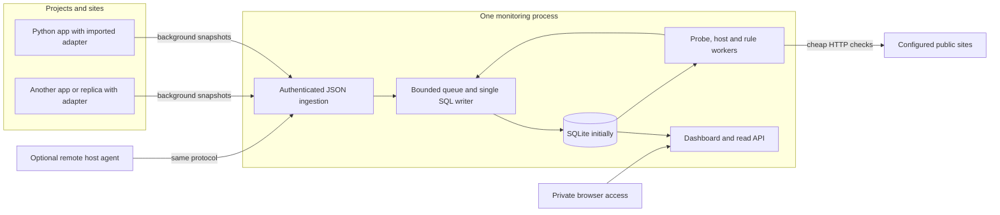

# Standalone monitoring for multiple projects

Status: design iteration 2, October 17, 2026. This replaces the infrastructure and packaging choices in the first proposal. It does not implement instrumentation, create the shared repository, or deploy a service.

Build a small, generic Python monitoring application: **one process, one private dashboard, one SQL database**. That process receives telemetry, probes sites, samples its host, evaluates alerts, maintains retention and serves the UI. Start with SQLite. Keep database operations behind a narrow storage interface so a server database can be added without changing application integrations or the dashboard.

Maintain the code in a separate shared repository, working name `small-monitor`. Projects include it as a pinned Git submodule and import its Python adapter directly. Flightrepo, Trip Dollar and future projects are configuration entries and examples, not special cases inside the monitoring core.

[Open the interactive dashboard study](monitoring-preview.html). It uses fictional data, makes no network requests and demonstrates grouping and failure states. It is a candidate layout for the built-in UI, not a functioning monitoring service.


## Decisions changed in this iteration

| Concern | Revised decision |
| --- | --- |
| Runtime | One supervised Python process; launchd or systemd as appropriate; a normal CLI is enough for development |
| Storage | All durable monitoring state in a relational SQL database; SQLite file first |
| UI | Small HTML/CSS/JavaScript interface served by the process; local SVG charts, no CDN or frontend build pipeline |
| Integration | Git submodule pinned by each parent repository; direct import, no adapter package installation |
| Collection | Background push from app adapters; local host sampling and public probes inside the central process |
| Remote hosts | Same repository can run a small optional host agent; app adapters use the same ingestion contract |
| Dependencies | Python 3.11+, Waitress for serving, psutil for portable host measurements; adapter uses only the standard library |
| Alerts | Small persisted threshold/state engine with dashboard incidents; one optional notification callback later |
| Industrial integrations | No required Grafana, Prometheus, Loki, Alloy, Alertmanager, OpenTelemetry, queue broker or container platform |

This trades a mature query/dashboard ecosystem for a deliberately narrow product that we own. Scope is a fixed operations overview, recent structured events and a few actionable rules. General dashboard builders, a custom query language, arbitrary log indexing, traces, automatic discovery, plugins and high availability are outside the initial scope.

## Runtime and deployment



The simplest installation runs beside the apps on the existing machine, binds to `127.0.0.1` and stores `monitor.sqlite3` in a private runtime directory outside every application checkout/release. An app release never starts, upgrades or deletes the shared daemon or its database. A single daemon serves many projects, sites and replicas. Adding another project does not create another database or dashboard installation.

The same daemon can move unchanged to a separate machine later. That placement gives better failure visibility; it is not a prerequisite for a local pilot. A colocated monitor cannot observe or notify during its own machine's sleep, power loss or network outage. Its UI shows the resulting time gap after recovery. Reliable notification of a dead monitoring host requires an independent checker later; an internal heartbeat alone cannot establish that.

Use a bounded worker pool for probes, a periodic scheduler, one writer thread and short-lived read connections in the same process. HTTP handling never runs probes, retention or large database scans synchronously. A hung target must not block another site, rule evaluation or the dashboard. Do not run several SQLite-backed daemon workers or embed one daemon in every app.

Illustrative commands and configuration below describe the proposed interface; they do not exist yet:

```sh
python -m smallmonitor init --config /private/runtime/monitor.toml
python -m smallmonitor serve --config /private/runtime/monitor.toml
python -m smallmonitor backup --config /private/runtime/monitor.toml --output /private/backups/monitor.sqlite3
# Only on an additional host that needs OS resource collection:
python -m smallmonitor agent --config /private/runtime/agent.toml
```

| Layer | Required software | Boundary |
| --- | --- | --- |
| Imported adapter | Python standard library | No third-party imports, network calls or startup work on import |
| Core | Waitress and psutil, pinned to tested versions | Waitress serves the private WSGI API/UI; psutil supplies OS metrics |
| Remote host agent, when used | psutil plus standard library | Same source tree; no dashboard, database server or collector distribution |
| Browser | Existing browser | Bundled assets, plain JS and SVG; polling rather than a websocket infrastructure |
| SQLite | Python `sqlite3` | No separate database process |
| Future server database | One selected DB-API driver | Added only when that backend is implemented |

Waitress is a maintained pure-Python WSGI server whose dependencies are in the standard library. A small WSGI router avoids adding Flask/FastAPI to the monitoring core. Use its request-size, connection and timeout limits rather than a development HTTP server. [Waitress](https://docs.pylonsproject.org/projects/waitress/en/stable/), [server limits](https://docs.pylonsproject.org/projects/waitress/en/stable/arguments.html). psutil covers process and system measurements across Linux and macOS; individual capabilities still need platform checks. [psutil](https://psutil.io/).

## Generic inventory and identity

A **project** groups related work. A **site** is a deployed service within a project and environment; it can be a website, API or worker. A **replica** is an expected serving slot on a **host**. Workers can omit public probes. Titles and URLs can change without changing IDs.

```toml
[monitor]
listen = "127.0.0.1:8720"
database_url = "sqlite:////private/runtime/monitor/monitor.sqlite3"
state_dir = "/private/runtime/monitor"
sample_seconds = 15
stale_seconds = 120

[[projects]]
id = "travel"
title = "Travel tools"

[[hosts]]
id = "mac-01"
title = "Serving Mac"
mode = "local" # remote hosts report through the optional agent

[[sites]]
id = "flight-web-prod"
project = "travel"
title = "Flight site"
environment = "production"
public_health_url = "https://example.invalid/health"
expected_body = "ok" # replace with the actual endpoint contract

[[replicas]]
id = "flight-web-mac-r01"
site = "flight-web-prod"
host = "mac-01"
slot = "r01"
# Add another replica or site using another entry, not another installation.
```

Inventory is operator-owned TOML loaded through `tomllib`, not a framework-specific plugin. Validate it completely before applying one SQL transaction; reject duplicate IDs, unknown parents and invalid cadences. Database rows persist the last accepted inventory, expected targets and retirement timestamps. A failed reload keeps the previous valid configuration and records an incident. Missing entries require explicit retirement, not silent deletion of expected targets. Restore from backup without the original TOML must still show historical identities; use the restored inventory until a new configuration is accepted.

Use stable project/site/host/replica IDs for all filtering and joins. Every process start creates a separate `run_id`; revision, adapter version and start time belong to that run. Replacing the same slot keeps the replica ID, while overlapping replicas need distinct IDs. Requests cannot set identity through headers. Credentials are provisioned against allowed identities; the server validates the claimed site/host/replica against that registration.

Host metrics belong to a host, recorded once even when it serves several projects. Public probes belong to sites. App metrics belong to replicas and runs. This prevents summing shared CPU or disk once per app. A central inventory retains an expected replica even after it stops reporting. Retirement ends missing-data checks but preserves history until retention expires.

## Git submodule and direct imports

Proposed shared repository layout:

```text
small-monitor/
  smallmonitor/
    __init__.py               # lightweight public adapter exports only
    adapter.py                # standard-library counters, sender and hooks
    asgi.py / wsgi.py         # protocol wrappers, no framework requirement
    core/                    # CLI, WSGI API, workers, rules and bundled UI
    storage/                 # storage contract and SQLite implementation
    migrations/sqlite/       # ordered, versioned migrations
    agent.py                 # optional remote host/process sampler
  examples/                  # generic ASGI, WSGI and worker integrations
  requirements-core.txt      # tested pins; not installed in consuming apps
  tests/
```

Each app adds the repository at `vendor/monitoring` using `git submodule add <shared-repository-url> vendor/monitoring`, then commits `.gitmodules` and the submodule pointer. Deployment clones with `--recurse-submodules` or runs `git submodule update --init --recursive` before assembling its release. The parent repository's commit pins the adapter revision; upgrades explicitly update that pointer and pass the app's smoke checks. No floating branch tracking or `pip install` of the adapter is required. [Git submodule workflow](https://git-scm.com/book/en/v2/Git-Tools-Submodules).

Since Git layout alone does not make Python modules importable, each application uses one explicit bootstrap:

```python
# Proposed API in the consuming project's composition root.
from pathlib import Path
import sys

MONITOR_SOURCE = Path(__file__).resolve().parents[1] / "vendor" / "monitoring"
sys.path.insert(0, str(MONITOR_SOURCE))
from smallmonitor import Monitor  # imported from the pinned checkout

monitor = Monitor(
    project="travel", site="flight-web-prod",
    host="mac-01", replica="flight-web-mac-r01",
    endpoint="http://127.0.0.1:8720/v1/ingest",
    token_file=Path("/private/runtime/flight-monitor-token"),
)
app = monitor.wrap_asgi(app)       # wrap_wsgi(app) for a WSGI site
# Call during serving-process startup, after fork:
monitor.start()
# On graceful shutdown: monitor.close(timeout=1.0)

with monitor.operation("search"):
    result = search(request)
monitor.result("search", outcome="empty")
monitor.job_success("daily_import", published_at=publication_time)
```

The relative root above is illustrative; the app must resolve its own source layout. Installed releases must explicitly copy the pinned submodule alongside the app and point the bootstrap there, or include it on `PYTHONPATH`. A release check verifies the imported file location, submodule commit and adapter version. Source-checkout imports alone are not sufficient for Flightrepo's installed deployment. Do not vendor a second copy through another package path.

The core never imports consuming projects. Generic adapters have no Flightrepo/Trip Dollar logic. Source hooks normalize framework route templates; bounded `unmatched` is the fallback. Missing submodules fail the release validation before rollout; the app's explicit monitoring-disabled mode must remain independently runnable. Core unavailability during normal serving never makes app startup or a request fail.

## Collection contract, overhead and failure behavior

The request path updates bounded, thread-safe counters, fixed histogram buckets and in-flight gauges in memory. It performs no telemetry disk writes or network calls. A background thread sends a self-contained cumulative snapshot every 15 seconds using standard-library HTTP. It has one in-flight send, a finite timeout, retry backoff with jitter and no unbounded queue of old metric snapshots. The next current snapshot replaces an unsent one. Event IDs and a bounded event ring handle recent errors/deployments separately.

Requests are finalized once, including exceptions, streaming completion/close, cancellation and admission rejection. In-flight values return to zero in `finally`. ASGI timing spans application response completion; WSGI spans iterable exhaustion/close. Disconnect timing is what the server can observe, not proof of when a browser stopped reading. Avoid logging request bodies and raw exceptions by default. Initialize per-process state after fork; multiworker deployments assign a distinct run per worker and group them under the replica. Shared memory or multiprocess metric files are unnecessary.

The versioned `/v1/ingest` envelope contains protocol version, registered producer identity, `run_id`, monotonic sequence, observation time, process elapsed time, cumulative request/operation totals and histogram buckets, current gauges, pending events and last-success job timestamps. The core validates field lengths, finite numbers, known units, nonnegative monotonic totals and fixed bucket schema. No user-defined SQL, expressions or arbitrary metric names are accepted; custom names are registered in inventory with bounded outcome/resource keys.

One proposed envelope limit is 256 KiB with 100 events. At most 50 route templates, 20 operation names, a fixed method set, status classes and outcome allowlists per producer are admitted. Apply an additional **total 500 active-series budget** per producer; independent dimension limits alone do not bound their cross product. Excess series merge into a bounded overflow category with a diagnostic. Capture all request counts regardless of event sampling.

The single SQL writer inserts a snapshot, updates the producer high-water mark/baseline, derives interval deltas, accepts unique event IDs and commits **in one transaction**. Return success only after commit. If the queue is full or the writer misses a finite deadline, return a retryable error, never a false acknowledgement. A duplicate sequence with the same payload is acknowledged without applying it twice; a conflicting payload is rejected. Older sequences never replace newer state. Runs are registered through their provisioned producer, not arbitrary client-generated identities.

| Event | Expected result |
| --- | --- |
| Retry after response loss | Stored sequence/event IDs prevent duplicate totals/events |
| Skipped snapshots while the app stays alive | Later cumulative values recover totals; exact timing within the gap remains unknown |
| First observation of a new run | Counts since process start can be retained over that actual interval; mark partial visibility if the first observation is delayed |
| App crash before its next successful snapshot | Final unobserved increments/events can be lost; previous SQL history remains |
| App redeploy/restart | Same replica, new run; no negative deltas across reset counters; old run stays historical |
| Core restart | Reopen SQL; baselines, inventory, incidents and high-water marks survive; unavailable intervals remain gaps |
| Core or network outage | Apps keep serving; current counters continue; bounded events may drop with an explicit dropped-event count |
| Disk full or database busy | Do not acknowledge failed writes; show degraded storage when possible; no retry storm or backpressure into app requests |
| Clock skew or delayed telemetry | Keep observation and receipt times plus process elapsed time; flag skew, mark replay as historical, never claim fresh liveness from a stale payload |

Liveness uses the latest progressing producer sequence, observation-time sanity and receipt age. Stale/unsupported values are not zeros. Use monotonic elapsed time for interval rates; reject counter decreases within a run or an incompatible histogram schema rather than inventing a reset. Carry durable baselines beyond raw-data retention for active runs. Late retired-run payloads cannot resurrect a replica; an accepted producer must begin a new registered run.

Remote applications use the same background push. A host agent is needed only for that remote host's OS metrics; it does not proxy every application or require another service suite. Its initial queue is bounded memory, with the same loss disclosure. A durable local spool is deferred until offline-delivery requirements justify it. The central database is the sole durable monitoring store in the initial design.

## SQL model and migration boundary

SQL persistence includes observations, structured events, job status, expected inventory, producer baselines, rollups, incident state, silences, notification attempts and schema version. There is no separate TSDB, object store or proprietary log database. SQLite is already a relational SQL database; the later change is to a server database, with PostgreSQL as the first proposed target. MySQL or Microsoft SQL Server would each require a tested backend rather than assuming they are interchangeable.

| Table group | Purpose |
| --- | --- |
| `projects`, `sites`, `hosts`, `replicas` | Stable identities, expected membership, environment and retirement |
| `producer_runs`, `batches` | Process identity, sequence/baseline, observed/received times, idempotency |
| `request_totals`, `histogram_totals` | Cumulative observations by bounded route/operation dimensions, including baseline records |
| `metric_samples`, `probe_results` | Typed numeric gauges/counters, capabilities and public/origin checks |
| `events`, `job_state` | Bounded structured errors/deployments; durable latest job progress and last success |
| `rollups`, `rollup_buckets` | Coarser request deltas and gauge summaries with coverage and histogram counts |
| `incidents`, `silences`, `notification_attempts` | Alert transitions, expiry, cooldown and optional delivery state |
| `schema_migrations` | Applied versions and migration checksums |

[Illustrative SQL schema](monitoring-schema.sql) makes identity, idempotency and histogram storage concrete. It is a review artifact, not a production migration. Full implementations of the remaining tables follow the same conventions.

Use explicit string IDs, `BIGINT` UTC epoch milliseconds and counts, finite floating-point gauge values, integer flags, foreign keys and ordinary composite indexes. Large request counters stay integers rather than JSON floats. Frequently filtered data is relational; bounded event details may use JSON text but queries cannot depend on engine-specific JSON functions. No SQLite `rowid`, implicit type coercion, SQL date arithmetic, generated IDs or vendor extensions in the domain layer.

Define the storage interface around `apply_inventory`, `commit_snapshot`, `record_probes`, `query_overview`, `query_series`, `query_events`, `transition_incident`, `rollup`, `prune`, `backup` and `migrate`. These operations own transaction boundaries. Parameter binding, conflict handling, index/DDL differences and connection management live in backend modules. Keep SQL queries small and explicit; an ORM is not an initial dependency. Database URL parsing rejects unimplemented backends at startup rather than falling back to SQLite. An eventual server driver is optional and loaded only for that backend.

Changing a database URL is **not** sufficient to migrate SQLite to a SQL server. The planned migration is:

1. Implement the PostgreSQL backend and versioned DDL; run the same storage contract suite, including transactions, duplicate ingestion, ordering, rollups and alert recovery, against both backends.
2. Back up SQLite and temporarily pause central ingestion, letting apps retain current in-memory totals. Create the target schema at the matching version.
3. Export/import tables in foreign-key order, preserving IDs, timestamps, baselines, high-water marks, incidents and migration version. Verify row counts, integer totals, histogram counts and representative dashboard queries.
4. Change the core connection configuration and restart; reconnect unchanged adapters. Exercise one duplicate snapshot and a new sequence to prove continuation without double counting.
5. Retain the frozen SQLite backup. Roll back before resuming writes if validation fails; rollback after accepting new server writes requires reconciliation, not just pointing back to an old file.

Domain logic and the wire protocol remain the same. SQLite and PostgreSQL will have different backup procedures, concurrency settings and migrations. This limited boundary provides a practical migration path without introducing a universal database abstraction now.

## SQLite operation, retention and recovery

Use `sqlite3`, WAL mode, foreign keys enabled on **each** connection, `synchronous=FULL`, a finite busy timeout and short bounded transactions. The writer owns its connection; request threads do not share it. Readers paginate and cap time ranges. WAL permits overlapping reads with a single writer; it does not make SQLite a multiwriter server, and the file must be on a local filesystem. Watch checkpoint age and WAL bytes; long read transactions can prevent checkpoint progress. [SQLite WAL](https://www.sqlite.org/wal.html).

Apply ordered migrations before serving, with a backup and checksum/version checks. Refuse a database newer than the running code. Migration DDL is backend-specific; most SQLite migrations are transactional, but do not assume every future server DDL operation is. Keep this state outside submodule and release folders.

Proposed defaults: retain 15-second raw snapshots for 48 hours, one-minute rollups for 30 days, hourly rollups for 180 days, events for 14 days and incident/deploy history for 180 days. Preserve active-run baselines and current job/incident state regardless of raw retention; prune retired high-water marks only after a defined replay rejection horizon. Retention is configurable per installation and is enforced by bounded scheduled deletes.

Rollups are idempotent, carry a generation watermark/coverage and complete before their source rows are deleted. Store counts, sums, minima/maxima, last gauge values and histogram **bucket counts**. Compute p95 after summing compatible buckets across replicas; never average p95s. Keep unsupported, partial and absent intervals distinguishable. Do not distribute recovered cumulative counts across missing minutes as if measured; expose a gap-spanning interval and exclude it from precise per-minute latency/traffic charts.

For scale perspective, 10 replicas emitting 40 scalar series every 15 seconds produce 2,304,000 scalar samples per day **before** histograms and events. This is a sizing example, not measured capacity. Batch writes, bounded dimensions and short raw retention matter more than an assumption that SQLite is unlimited. During the pilot measure row counts, database/WAL growth, write latency, queue pressure, rollup duration and dashboard response time. Start with a configurable 5-GiB storage budget and free-space reserve; database file size is not reduced just because rows expire. Reuse free pages, report physical/used size separately and perform compaction only as planned maintenance. If growth exceeds budget, drop low-priority telemetry with visible counters rather than fill the application disk. When storage is exhausted, even the diagnostic may survive only in the daemon's rotating local log.

Create consistent snapshots with `sqlite3.Connection.backup`, not by copying the main file while a live WAL exists. Back up inventory/configuration alongside the database; store credentials separately. Restore into a clean runtime, run integrity/foreign-key checks and compare historical charts, active incidents and producer baselines before reopening ingestion. A backup on the same disk is not protection from disk loss. Initial targets are a daily backup and a tested manual restore; actual recovery time is measured during the pilot. [Python backup API](https://docs.python.org/3.11/library/sqlite3.html#sqlite3.Connection.backup), [SQLite backup behavior](https://www.sqlite.org/backup.html).

## Functional coverage without specialized integrations

| Requirement | Small initial implementation |
| --- | --- |
| Availability | Core checks each configured public health URL every 30 seconds, status plus bounded expected body, five-second timeout; optional cheap origin check |
| Traffic/errors | Adapter counters by route template, normalized method/status/outcome; exclude probes/assets from user-facing totals |
| Latency | Fixed histogram buckets, counts and sums for request/operation durations; common schema across replicas |
| CPU/memory | psutil host CPU, available memory and swap every 15 seconds; per-process CPU/RSS only when the adapter explicitly enables psutil or an authorized local sampler can identify the process |
| Disk/network | Host disk capacity, I/O and network counters; use inventory-selected durable volumes and deduplicate shared mounts |
| Database health | Generic timed check callback or explicit operation hook for connection/schema readiness, lock/error counts and optional file/WAL size; never grant the core access to application DB credentials by default |
| Ingestion/progress | Explicit `job_progress`, `job_success`, `job_failure` hooks, bounded job IDs and durable last-success timestamps |
| Data freshness | Time of the last successful publication/refresh, expected cadence and grace; independent of process liveness or the newest business-data date |
| Logs/events | Bounded structured errors, warnings, deployment and job events into SQL, searchable by project/site/host/replica/time/severity |
| Monitoring health | Worker heartbeat, current queue, rejected/dropped events, storage/WAL, probe errors, rule/rollup/retention progress and backup age |

Fixed request histogram upper bounds can start at 5, 10, 25, 50, 100, 250, 500 ms; 1, 2.5, 5, 10, 30 and 120 s; plus an overflow bucket. Buckets on the wire are noncumulative counts whose sum equals the duration count; the core validates this. A percentile in the overflow bucket displays `>120 s`; small samples display their count and an approximate indicator. A bucket schema version prevents combining incompatible deployments. Rates and error shares use summed counts and actual elapsed intervals, not averages of per-replica rates/percentages.

Base host CPU/memory/disk/network coverage requires psutil in the core/agent environment. The zero-dependency adapter does not promise portable RSS or file-descriptor measurements. Unsupported platform/process fields display **Unsupported**; missing expected telemetry displays **No recent data**. Check actual Darwin semantics and APFS shared-volume accounting in the pilot. Never export command lines or environment variables.

Structured events are a small operational journal, not full log aggregation. Keep complete application logs under existing local rotation. Exception hooks accept an error class/code and a redacted summary; exclude raw SQL, credentials, headers, query strings, bodies, IP addresses and business input. No continuous file tailing, stack-trace search engine, distributed tracing, cloud API discovery or Cloudflare exporter is required. Tunnel failures initially surface through the difference between public probes and app heartbeat/origin health. A later connector hook can be added only if this leaves an actionable diagnosis gap.

Public probes cannot prove every replica is healthy. Expensive readiness scans or application searches are never frequent probes. For Flightrepo, main `683b737` now has cheap `/health` and `/health/ready` endpoints; readiness validates the serving schema without counting flight facts. Use those for liveness/readiness, keep catalog/search out of frequent probes, and use explicit publication/job hooks. Trip Dollar uses its cheap health endpoint plus calculation/outcome hooks. Recheck integration paths against each app at implementation time. Deterministic functional/browser smoke checks remain deployment checks; this core does not run a browser fleet or paid upstream calls.

## Built-in dashboard and simple alerts

The default screen shows one card per site, grouped/filterable by project and environment. Each has public availability, last telemetry time, request count/rate, error share, approximate p95 and a compact replica table. A single chart combines the site total with optional replica lines. Replica selection filters adjacent events; host resource panels appear once per host. Time range, deployment markers, sample count and data coverage remain visible. Site definitions drive this layout without per-project frontend code.

Use separate states for **Public available**, **Public unavailable**, **Replica degraded**, **No recent data**, **No requests**, **Unsupported** and **Not configured**. Public status comes from the probe result, never inferred from summed replica heartbeats. A stale probe becomes unknown; a missing heartbeat does not prove a host or app is dead. Partial totals are labelled with reporting/expected counts. The preview's host-offline scenario stipulates a confirmed outage; normal operation must retain uncertainty until independently established.

Events support bounded indexed filters and paginated recent results, not arbitrary regex over unlimited logs. Poll the read API every 15 seconds; no live data feed dependency. Keep historical queries bounded and serve bundled assets without network access.

Evaluate a small built-in rule set every 30 seconds. Persist the pending/firing/resolved state, transition times, grouping key and expiring silence in SQL so a core restart does not re-open every incident. After a monitoring gap, re-evaluate from fresh evidence; never count unobserved downtime as confirmed failure. Data-dependent rules become unknown when their source expires and do not resolve on absent data.

| Rule | Proposed initial behavior |
| --- | --- |
| Public outage | Three consecutive fresh failed probes; group by site/environment |
| Missing app or host telemetry | No progressing heartbeat for two minutes; label as telemetry loss, not proven outage |
| High error share | More than 5% server errors over five minutes, at least 20 requests and sufficient data coverage |
| Resource pressure | Sustained CPU >90%, memory available <10%, disk below configured byte/percentage reserve; expose which condition fired |
| Stale job/data | Configured cadence plus grace exceeded since last success; never-successful jobs are distinct |
| Core degradation | Writer, queue, rule/rollup worker or backup age breaches configured budget |

Use a host telemetry incident to group dependent missing-heartbeat notices, but do not suppress independently failed public probes. Dashboard incidents are the baseline. Later add **one** configured notification sink through a standard-library callback (for example SMTP), disabled until configured. Persist attempts, retry with a finite budget and cooldown, and tolerate possible duplicate delivery after response loss. Do not add a notification integration framework, SLO engine or externally enabled destination in this proposal.

## Private access and operational limits

Bind the service to loopback by default. Local browser access or SSH port forwarding provides the first admin workflow; no purchased server, DNS route, reverse proxy or cloud account is required. Use distinct random admin and producer tokens stored in private files, hashed for lookup/comparison server-side, with constant-time secret comparisons and identity scopes. Never put tokens in URLs, inventory committed to Git, HTML bundles or command arguments.

For this small private tool, a browser can hold the admin token in tab memory and send it in an authorization header; avoid persistent local storage and query-string login. Serve a login shell without data, require authorization for all read/write APIs, disable CORS and apply restrictive host/origin checks. Escape event text, use a CSP and cap body sizes/rates. No SQL-console or remote-command endpoint belongs in the UI.

Waitress does not terminate TLS. Keep remote traffic inside SSH forwarding initially; on a remote app host a supervised local forward can expose the central loopback ingest address locally. Non-loopback deployment must explicitly supply verified HTTPS through an existing TLS endpoint or a private encrypted transport; do not quietly send bearer tokens over ordinary LAN/Internet HTTP. Choosing that transport is a deployment concern when a remote host is actually added, not a reason to introduce more servers into the first local installation.

Probe destinations are trusted operator configuration, not fields accepted from telemetry or browser requests. Restrict redirects/response size, preserve certificate verification, and never scrape arbitrary URLs supplied by an app. Core and agent run with ordinary user permissions. Use OS supervision and rotating daemon diagnostics, not root access or an application-managed service installer.

The first implementation supports a modest fleet and one operator installation. It does not promise complete audit logging, zero-loss crash delivery, multi-tenant security isolation, high availability or unlimited retention. Multi-project grouping is an organizational feature within one trusted installation. Move to a server database when measured write/query/retention pressure warrants it; that alone does not add redundant monitoring availability.

## Delivery sequence and review gates

1. **Standalone core:** shared repository, direct CLI, inventory, SQLite migrations, ingestion, probes, host sampler, fixed UI and dashboard incidents. Show two example projects/sites using simulated producers before touching either real app.
2. **Submodule integrations:** add pinned submodules and tiny ASGI/WSGI composition hooks in separate app changes. Verify installed releases include/import the pinned source. Add opt-in database/job/freshness hooks where the application owns the facts.
3. **Operational pilot:** restore backup, bound retention/storage, exercise failure states and measure overhead/footprint. Run one central process on the existing machine; record its same-host outage limitation.
4. **Only as needed:** remote-host agent/transport, one notification callback, then a server-database backend with migration rehearsal. Existing applications and their protocol do not change for a database migration.

Implementation acceptance checks:

- Add a third project/site by inventory alone; aggregate several replicas on one/two hosts without double-counting host resources. Public availability and per-replica telemetry remain independent.
- Test ASGI/WSGI success, exception, rejection, streaming, close/cancellation and multiple worker runs; count once and return in-flight to zero. Compare representative p95 with instrumentation off/on; target <5% regression plus an absolute check for fast routes, measured rather than claimed.
- Retry committed snapshots, reuse/conflict event IDs, send out-of-order sequences, reset counters, change histogram versions and skew clocks. Totals stay correct; data gaps/partial coverage are explicit; first-run and restart baselines work.
- Kill/restart the app and daemon independently. Keep historical identity/SQL state, active incidents and job last success. Verify pending alerts do not treat monitor downtime as observed app downtime.
- Simulate timeouts, unavailable core, full queues, disk exhaustion and locked SQL. Apps continue serving; request paths perform no telemetry network/disk I/O; dropped/rejected telemetry is visible.
- Re-run rollups and interrupt pruning; no duplicate aggregates or deletion before aggregation. Restore the SQLite backup onto a clean runtime and verify history, baselines, inventory and active alerts.
- Validate credential scopes, unsafe payloads, cardinality limits, redaction, HTML escaping and inaccessible unauthenticated APIs. No required external browser requests or public metrics endpoint.
- Verify CPU/memory/disk/network on the actual Mac/Linux hosts; mark unavailable capabilities explicitly. Measure database/WAL growth and enforce storage headroom without exhausting the app disk.
- Before calling a server backend supported, run the same contract suite on it and rehearse the SQLite export/import, continued ingestion and pre-cutover rollback.

This design review needs no infrastructure or credential decisions to proceed. The concrete first build is a generic single-process Python tool, two core dependencies, a standard SQL file and a directly importable submodule adapter.
